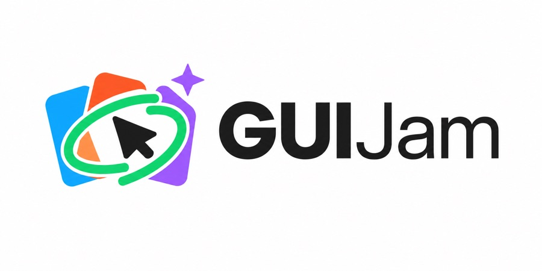

<p align="center">
  
</p>

<p align="center">
  <strong>Draw on your running app. Get live UI variants. Keep the one you like as a real source edit.</strong>
</p>

<p align="center">
  <a href="https://www.npmjs.com/package/guijam"></a>
  <a href="https://github.com/francistinao/gui-jam/actions/workflows/test.yml"></a>
  <a href="LICENSE"></a>
</p>

---

## Introduction

GUIJam turns the app running in your dev server into an editable canvas. Point at an element, circle it, or sketch what you want, describe the change in plain words, and GUIJam previews it live in the page before anything touches your files. When you keep a change, it lands as a minimal edit in the component that renders it, with one-click undo.

GUIJam drives the AI coding CLI you already use and are logged into, such as Claude Code, Codex or OpenCode. There are no API keys to configure and no credentials leave your machine. Everything runs only in development: production builds are the same with or without it.

## Quick start

In your app's folder, run:

```bash
npx guijam@latest init
```

`init` walks you through the setup:

1. Detects your package manager, framework and styling.
2. Adds `guijam` as a dev dependency.
3. Wires GUIJam into your framework's config, as shown in [Supported frameworks](#supported-frameworks). If the config is too dynamic to edit safely, it shows the lines to add.
4. Lists the AI coding CLIs on your machine and saves the one you pick. With OpenCode it also lets you choose the model, such as DeepSeek or GLM.
5. Runs that CLI's own login if you aren't logged in yet. GUIJam never reads your credentials.

Then start your dev server as usual, for example `npm run dev`. The GUIJam toolbar appears at the bottom right of your page.

| Tool | What to do |
|---|---|
| **Select** | Click any element. Tweak its fill and corner radius in a Figma-style panel, then **Apply**. |
| **Draw** | Circle an element and describe the change. Pick one of three live variants and **Use** it. Up to three drawings can generate at once, each behind a numbered badge. |
| **Draw** (sketch) | Sketch a card, a section or an icon where you want it. GUIJam works out the component and where it goes. |
| **Ask** | Ask a question about what you see, such as "what's the path of this image?" |

Every applied change shows an **Undo** for 10 seconds, and `Alt+Shift+M` hides the toolbar.

See [Commands](#commands) for everything else, including how to switch the AI tool.

## Commands

Run these in your app's folder.

| Command | What it does |
|---|---|
| `npx guijam init` | Sets up GUIJam: adds the package, wires your framework's config, and picks your AI tool and logs it in. Safe to run again. |
| `npx guijam doctor` | Checks Node, your framework, the config wiring, the `gjd` daemon and your AI tool's login. |
| `npx guijam doctor --probe` | Also sends one short test request to your AI tool, to show it answers. Spends a few tokens. |
| `npx guijam provider list` | Lists the AI coding CLIs GUIJam can drive, and whether each is installed and logged in. |
| `npx guijam provider use <id>` | Switches the AI tool: `claude-code`, `codex`, `opencode`, `qwen-code` or `gemini-cli`. |
| `npx guijam provider use opencode --model <id>` | With OpenCode, also picks the model, such as `deepseek/deepseek-chat`. |
| `npx guijam --help` | Shows every command and option. |

Options for `init`:

| Option | What it does |
|---|---|
| `-y`, `--yes` | Uses the defaults instead of asking |
| `--provider <id>` | The AI tool to use |
| `--model <id>` | The model to use with it |
| `--skip-install` | Doesn't add `guijam` to `package.json` |
| `--cwd <dir>` | Runs in another folder |

The AI tool you pick is saved for your user in `~/.config/guijam/config.toml`, applies to every project, and takes effect on your next request without restarting the dev server.

### In the page

| Key | What it does |
|---|---|
| `Esc` | Leaves the active tool |
| `Alt+Shift+M` | Hides or shows the toolbar |

### Settings

| Variable | What it does |
|---|---|
| `GUIJAM_GJD_BIN` | Path to a `gjd` binary to use instead of the one installed from npm |
| `GUIJAM_BROWSER` | Path to the Chromium-based browser that takes screenshots of links in your prompts. By default GUIJam finds Chrome, Brave, Edge or Chromium. |
| `XDG_CONFIG_HOME` | Moves the saved AI tool choice to `$XDG_CONFIG_HOME/guijam/config.toml`. Without it, the choice is saved in `~/.config/guijam/` on macOS and Linux and in `%APPDATA%\guijam\` on Windows. |

GUIJam keeps its run state, logs and undo journal in `.guijam/` in your project. `init` adds that folder to `.gitignore`.

## Supported frameworks

| Framework | What `init` adds | Previews |
|---|---|---|
| Vite 6, 7 or 8 with React, Preact, Solid, Vue or Svelte | `guijam()` first in `vite.config` | Live, through hot reload |
| Laravel, Inertia, or any backend that renders the HTML | `guijam()` first in `vite.config` | Live. GUIJam loads from your Vite script entries. |
| SvelteKit | `guijam()` before `sveltekit()` | Live |
| Nuxt 4 | `'guijam/nuxt'` in `modules` | Live |
| React Router 7 or 8, framework mode | `guijam()` before `reactRouter()` | Live |
| SolidStart 2 (needs Node 24) | `guijam()` before `solidStart()` | Live |
| Astro 7 | `guijam()` from `guijam/astro` in `integrations` | Fine-tune changes the page in place. AI variants re-render the page, and the panel comes back after the reload. Islands update live. |
| Next.js 16.3 or later, App Router, Turbopack or webpack | `withGuijam(...)` from `guijam/next` around your config | Live, for client and server components |

**Styling.** Fine-tune writes Tailwind CSS classes when your project uses Tailwind, `color` and `rounded` props on Vuetify components, and inline styles everywhere else. Draw and Ask work with any CSS.

**Not supported yet:** Windows on Arm, Angular, SolidStart 1 (vinxi) and the Next.js Pages Router. In Next.js, a sketch that would create new component files can't be previewed yet.

### Requirements

- Node `^20.19.0` or `>=22.12.0` on macOS (Apple silicon or Intel), Linux (x64 or arm64) or Windows (x64). SolidStart 2 itself needs Node 24.
- One of the frameworks above.
- An AI coding CLI, installed and logged in: [Claude Code](https://claude.com/claude-code), [Codex](https://github.com/openai/codex), [OpenCode](https://opencode.ai), [Gemini CLI](https://github.com/google-gemini/gemini-cli) or [Qwen Code](https://github.com/QwenLM/qwen-code). `init` helps you pick one and log in, and `npx guijam doctor --probe` shows whether it answers.
  - OpenCode needs a key for the model you pick, added with `opencode auth login` (for example DeepSeek, OpenRouter or OpenCode Zen). OpenCode's free `opencode/*` models only answer OpenCode itself, and an OpenCode Zen model must be switched on in the Zen console, with credit.
  - Gemini CLI needs a `GEMINI_API_KEY` (from [AI Studio](https://aistudio.google.com/apikey)) chosen with `gemini`, then `/auth`, then "Use Gemini API Key". Google no longer serves Gemini CLI to a personal Google login. GUIJam uses `gemini-3-flash-preview` unless you pick another model with `npx guijam provider use gemini-cli --model <id>`.
  - Qwen Code needs a Qwen plan or another provider's key, set with `qwen`, then `/auth`. Qwen's free OAuth tier ended on 2026-04-15.

### Pages rendered by a backend

With Laravel's `@vite` directive, Inertia, or any server that renders the HTML itself, Vite never sees an `index.html`. GUIJam then loads from the script entries in `build.rollupOptions.input`, which `laravel-vite-plugin` already sets. No extra setup is needed.

## Core features

- **Source-mapped elements.** Every element knows the file, line and column that rendered it, in JSX, Vue, Svelte and Astro templates, including polymorphic components such as `asChild` buttons and Vue component usages.
- **Live previews, never written early.** Previews are served from memory through Vite's module graph or, in Next.js, through files GUIJam keeps in `.guijam/`. Switching between variants never changes your source files.
- **Fine-tune like a design tool.** The panel reads the element's real classes and styles, prefers your theme tokens, and writes a one-line change.
- **Three variants per request.** One call to your CLI returns three takes on the request, with live progress while it works.
- **Exact edits without AI.** Prompts like "make it blue and pill-shaped" become a precise edit instantly, with no model call. Ask for AI variations when you want them.
- **Answers, not just edits.** Ask about an element and get an answer that points at the files involved.
- **References across the page.** "Use the image from the navbar here" works, because GUIJam indexes your project's assets and the page you are looking at.
- **Sketch to UI.** Rough out a layout or an icon. GUIJam sends the sketch and a screenshot of the page, then places the new markup in the right component, split into atoms, molecules and organisms when your project has components.
- **Inspiration and links.** Paste or drop images next to your prompt, or paste a link: GUIJam reads the page's text, colors and fonts, and takes a screenshot with your installed Chromium browser.
- **3D and motion when asked.** Requests that need three.js, Motion or GSAP can use them, after you approve the install.
- **Safe writes.** Edits are journaled with the exact previous bytes, conflicts with your own unsaved work are refused, and undo restores files exactly.
- **Your CLI, your login.** GUIJam runs the provider CLI headlessly with no write tools and never reads its credentials.

## Architecture

```
 Browser                       Dev server                      gjd daemon (Rust)               Provider CLI
┌──────────────────┐        ┌────────────────────────┐   WS    ┌───────────────────────┐ stdio ┌──────────────┐
│ GUIJam widget    │◀──────▶│ guijam() plugin, or    │◀───────▶│ inspect · patch ·     │◀─────▶│ Your AI CLI  │
│ in a shadow root │        │ withGuijam() in Next   │  token  │ journal · routing ·   │       │ (headless)   │
└──────────────────┘        └────────────────────────┘         │ providers             │       └──────────────┘
                                                               └───────────────────────┘
```

- **The widget** lives in a shadow root, so your app's styles never leak into it and its styles never leak out. It talks only to your dev server: Vite's hot-reload channel, or a localhost relay in Next.js.
- **The Vite plugin** adds source locations to elements, serves previews from memory in place of the files on disk, and reports whether each hot update succeeded.
- **In Next.js**, `withGuijam()` adds a loader that marks elements and serves previews, loads the toolbar through `instrumentationClientInject`, and starts a relay on localhost that connects the page to `gjd` with a per-session token.
- **The `gjd` daemon** is the only process that writes to your project. It reads the element's source, routes each request, runs your CLI, validates every proposed edit against the current file, and journals each commit for undo. It listens on localhost only and requires a per-session token.
- **Your CLI** receives the relevant code inline and answers with structured edits. It is never given tools that can change files.

## Development

Requirements: Node 22.18 or later, pnpm 10, and Rust (the pinned toolchain in `rust-toolchain.toml` is installed by rustup).

```bash
git clone https://github.com/francistinao/gui-jam.git
cd gui-jam
pnpm install
pnpm exec playwright install chromium
cargo build -p gjd-daemon
pnpm build
```

Run the example app against your own checkout:

```bash
GUIJAM_GJD_BIN=$PWD/target/debug/gjd pnpm --filter small-react-tailwind4 dev
```

Try GUIJam in one of your own Vite apps without changing its tracked files, then remove it again:

```bash
scripts/try-guijam.sh setup ../my-app
scripts/try-guijam.sh clean ../my-app
```

Create fresh apps for every supported framework with their official starters and a real `guijam init`, then test them all:

```bash
scripts/playground.sh
pnpm test:playground
```

Try the setup CLI on any app:

```bash
GUIJAM_GJD_BIN=$PWD/target/debug/gjd node packages/guijam/dist/cli.js init --skip-install --cwd ../my-app
```

Run every check the CI runs, stopping at the first failure:

```bash
scripts/gate.sh
```

| Command | What it does |
|---|---|
| `pnpm build` | Builds every package; the fixtures use the built output |
| `pnpm check` | Lints and formats with Biome |
| `pnpm typecheck` | Type-checks the packages and the fixtures |
| `pnpm test` | Runs the unit tests (Vitest) |
| `pnpm test:e2e` | Builds, then runs the browser tests (Playwright) against the fixtures |
| `pnpm test:playground` | Builds, then runs the browser tests against the apps `scripts/playground.sh` creates |
| `pnpm contracts:gen` | Regenerates the TypeScript and Rust types from `contracts/` |
| `pnpm contracts:check` | Fails if the generated contracts are out of date |
| `cargo fmt --all --check` | Checks Rust formatting |
| `cargo clippy --workspace --all-targets -- -D warnings` | Lints the Rust code |
| `cargo test --workspace` | Runs the Rust tests |
| `scripts/smoke-package.sh` | Packs `guijam`, installs it outside the workspace, and checks that it loads and type-checks |
| `scripts/try-guijam.sh setup\|clean <app>` | Adds GUIJam to one of your Vite apps without touching tracked files, or removes it |
| `scripts/playground.sh [app]` | Creates or refreshes the playground apps; `GUIJAM_SPEC=guijam@X.Y.Z` installs a published version |
| `scripts/release-local.sh build\|publish <version>` | Builds or publishes a release from a Mac when GitHub Actions is unavailable |
| `cargo run -p gjd-daemon -- provider list` | Lists the AI CLIs as the daemon sees them |
| `cargo run -p gjd-daemon -- provider test claude-code --runs 5` | Runs a real CLI five times and reports timings (spends tokens) |
| `GUIJAM_LIVE_PROVIDER=<id> pnpm exec playwright test tests/e2e/live-provider.spec.ts` | Runs a real Draw and a question through the widget with a real AI tool; `GUIJAM_LIVE_MODEL` picks the model (spends tokens) |

| Path | What it is |
|---|---|
| `packages/guijam` | The published package: `guijam/vite`, `guijam/nuxt`, `guijam/astro`, `guijam/next` and the `guijam` CLI |
| `packages/vite-plugin` | Source locations, in-memory previews, hot-update tracking, and the Next.js loader and relay |
| `packages/overlay` | The browser widget (React in a shadow root) |
| `packages/contracts-ts` | TypeScript types generated from `contracts/` |
| `contracts/` | JSON Schemas shared by every process |
| `crates/gjd-core` | Source inspection, the patch engine and the journal |
| `crates/gjd-providers` | Provider CLI adapters |
| `crates/gjd-daemon` | The `gjd` binary |
| `fixtures/` | Apps the tests run against |
| `tests/e2e/` | Playwright suites |
| `tests/playground/` | Playwright suite for the apps `scripts/playground.sh` creates |

### Releasing

Versions come from the release tag; nothing in the repo needs a version bump.

1. Publish a GitHub release tagged `vX.Y.Z-rc.N` and marked as a pre-release. CI runs every check on the tag, builds `gjd` for macOS (arm64, x64), Linux (x64, arm64) and Windows (x64), publishes it as `@guijam/gjd-<os>-<arch>` packages, which `guijam` installs as optional dependencies, then publishes `guijam` under the `next` dist-tag. Packages already on npm are skipped, so a failed release can be run again.
2. Try it from npm: `npx guijam@next init` in an app, or `GUIJAM_SPEC=guijam@X.Y.Z-rc.N scripts/playground.sh` followed by `pnpm test:playground`.
3. Publish the release `vX.Y.Z` to move `latest`.

npm requires two-factor authentication to publish. For CI, either set up npm trusted publishing on each of the six packages (GitHub Actions, workflow `release.yml`, environment `npm`), or store a granular token with "Bypass two-factor authentication" as the `NPM_TOKEN` secret. The `npm-check` workflow (Actions, then Run workflow) confirms that the token works and belongs to the `guijam` organization, and publishes nothing.

Without GitHub Actions, release from a Mac with zig and `cargo-zigbuild` installed and the cross targets added (`rustup target add x86_64-apple-darwin x86_64-unknown-linux-musl aarch64-unknown-linux-musl x86_64-pc-windows-gnu`): `scripts/release-local.sh build X.Y.Z` builds and smoke-tests everything, then `scripts/release-local.sh publish X.Y.Z next` (or `latest`) publishes it and asks for your npm one-time password.

## Credits

- [FigUI](https://github.com/anxndsgn/figui) by anxndsgn (MIT), the Figma-style components the widget is built from
- [Base UI](https://base-ui.com), [React](https://react.dev) and [Tailwind CSS](https://tailwindcss.com)
- [Vite](https://vite.dev) and the [oxc](https://oxc.rs) parser
- [Tokio](https://tokio.rs) and [axum](https://github.com/tokio-rs/axum)
- [Clack](https://github.com/bombshell-dev/clack) and [magicast](https://github.com/unjs/magicast), behind `guijam init`
- [Claude Code](https://claude.com/claude-code), [Codex](https://github.com/openai/codex) and [OpenCode](https://opencode.ai), the CLIs GUIJam drives

## License

[MIT](LICENSE)